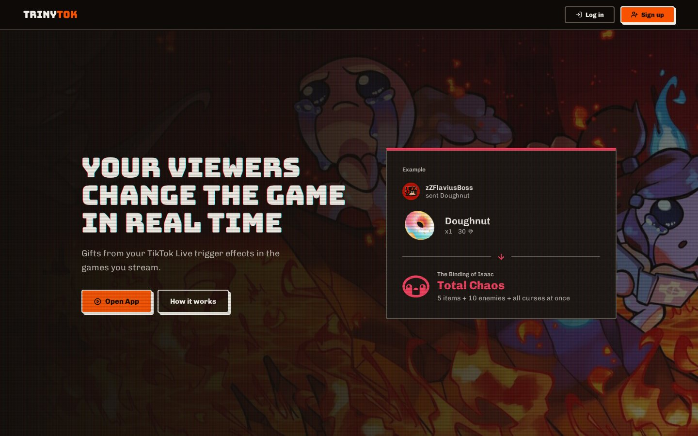
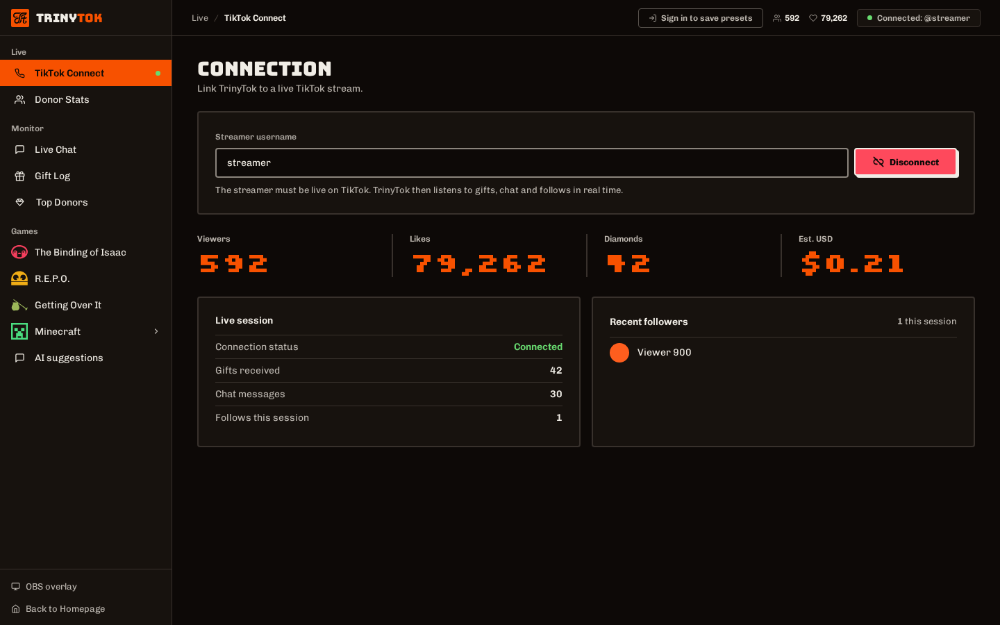
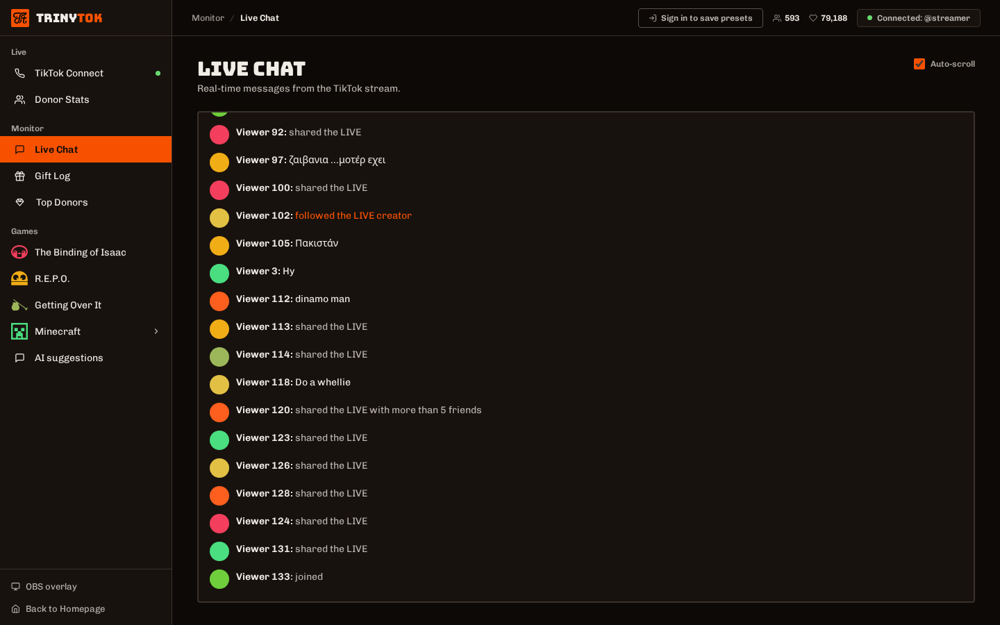
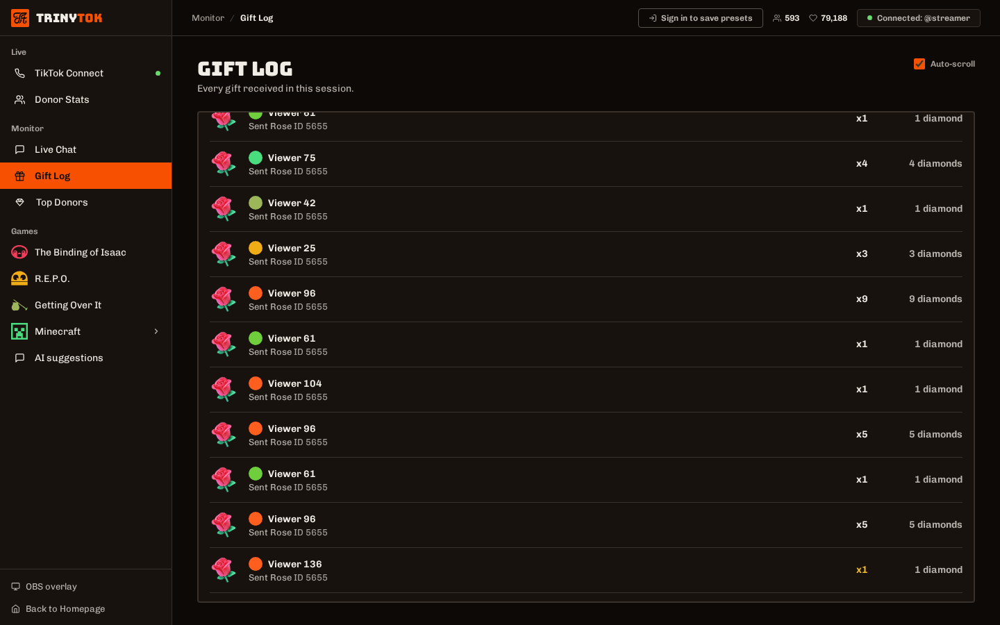
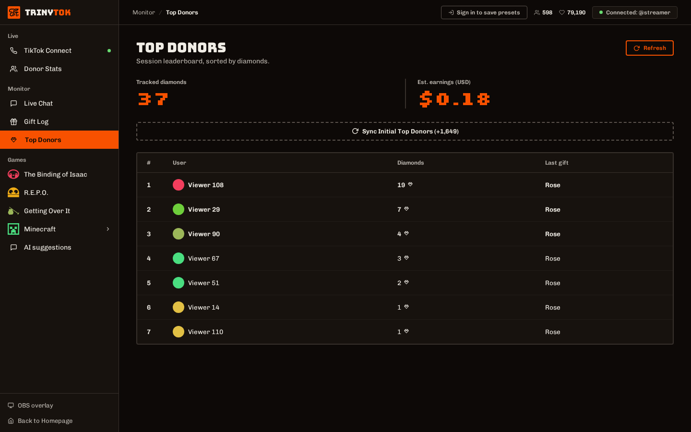
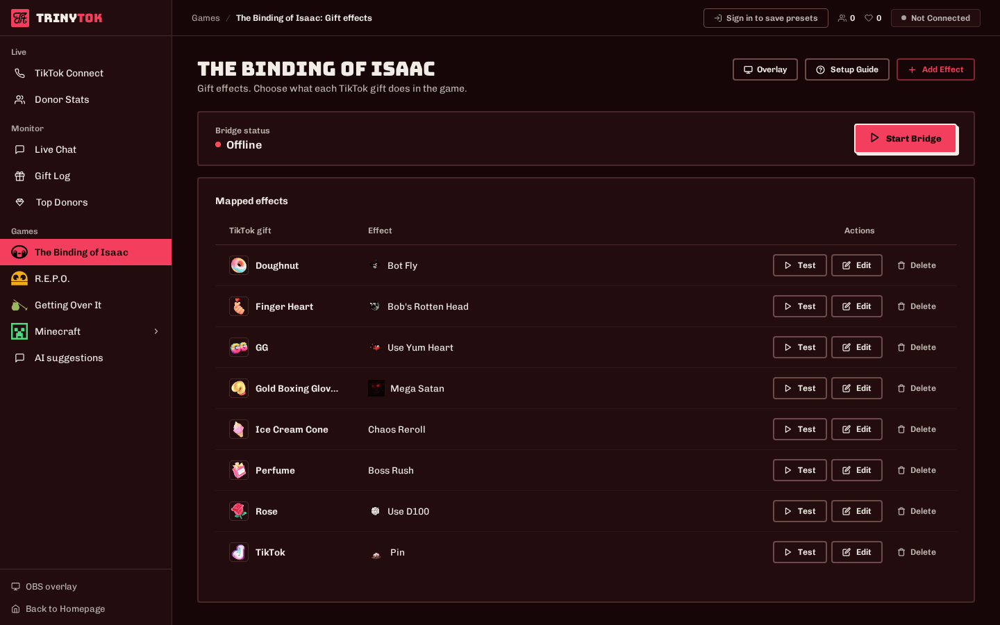
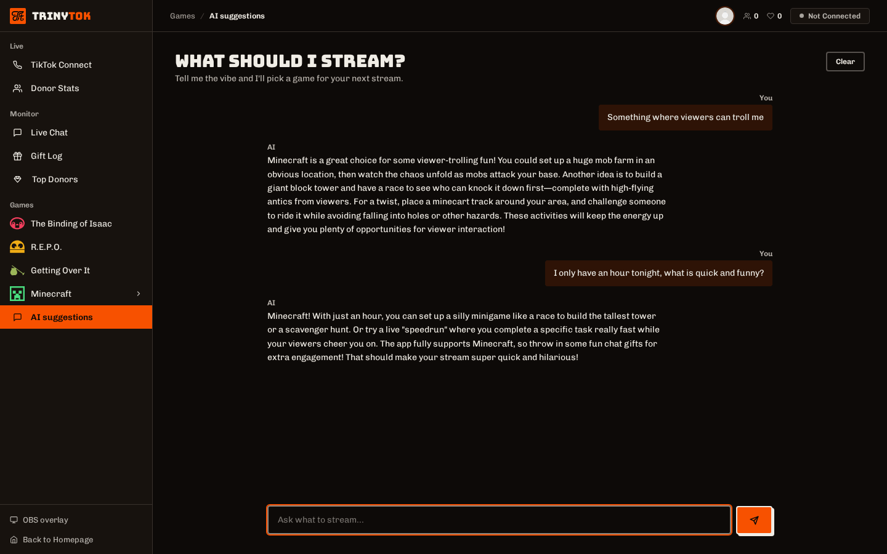
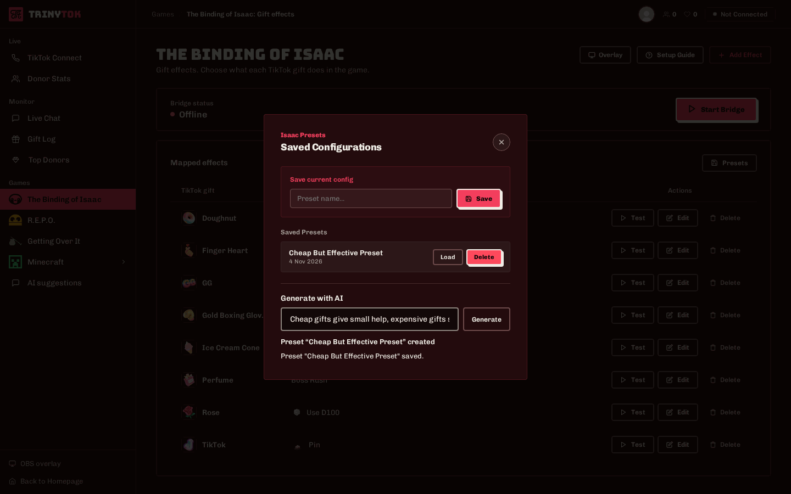

# TrinyTok

Connects a TikTok LIVE to the game you're playing. When a viewer sends a gift, follows or likes, something happens in the game: a boss spawns, gravity turns off, your character dies.



**This is not open source.** You can read the code and run it for your own streams, but you can't republish it, sell it or reuse it in another product. See [LICENSE](LICENSE).

It started as a project for the *Metode de Dezvoltare Software* course at university.

## Supported games

| Game | Connection | Mod |
|------|------------|-----|
| Minecraft (Java) | RCON | not needed |
| The Binding of Isaac: Repentance | local TCP, port 58430 | [Triny-Tok-TBOI-Mod](https://github.com/Pencea-Flavius/Triny-Tok-TBOI-Mod) |
| R.E.P.O. | local TCP, port 51337 | [Triny-Tok-R.E.P.O.-Mod](https://github.com/Pencea-Flavius/Triny-Tok-R.E.P.O.-Mod) |
| Getting Over It | local TCP, port 52000 | [Triny-Tok-Getting-over-it-Mod](https://github.com/Pencea-Flavius/Triny-Tok-Getting-over-it-Mod) |

Each game's page in the app has a setup guide.

## Running it

You need Node.js 20 or newer.

```bash
git clone https://github.com/Pencea-Flavius/Triny-Tok.git
cd Triny-Tok
npm install
cp .env.example .env
npm start
```

Open http://localhost:8081, enter a TikTok username that is live, then pick a game, start its bridge and choose what each gift does.

You don't need an account unless you want to save presets or use the AI.

## Screenshots

These come from a real live. Every username and profile picture, the streamer's included, was replaced before the capture.









Mapping gifts to effects:



Asking the AI what to stream, and having it build a preset. It runs on your PC through [Ollama](https://ollama.com):





## Settings

All of these go in `.env`, and none are needed just to try it on your own PC.

| Name | Used for |
|------|----------|
| `SESSION_SECRET` | keeping you logged in after a restart (required in production) |
| `SMTP_HOST`, `SMTP_PORT`, `SMTP_USER`, `SMTP_PASS` | verification and password reset emails |
| `OLLAMA_URL`, `OLLAMA_MODEL` | the AI (run `ollama pull qwen2.5:7b` first) |
| `PORT` | the app's port, 8081 by default |
| `HOST` | `127.0.0.1` keeps the app on this PC. `0.0.0.0` opens it to your network, and changes then need an admin login |
| `BRIDGE_HOST` | set to `0.0.0.0` only if a game mod runs on another PC |

## License

Copyright (c) 2026 Pencea Flavius. All rights reserved. The terms are in [LICENSE](LICENSE).

TrinyTok isn't affiliated with TikTok or with the makers of these games.
